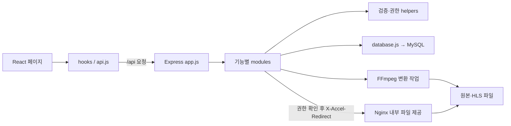

# MathSite 인수인계서

작성일: 2026-11-14. 팀원이 이 문서로 실행하고, 기능을 찾고, 코드를 수정하는 것을 목표로 한다. 현재 기준은 **로컬 `codex/react-frontend-20261114` 브랜치의 작업 파일**이다. GitHub에 푸시하지 않았다.

## 1. 먼저 알아둘 프로젝트 규칙

MathSite는 관리자가 학생을 승인하고 **학생별로 특정 강의 영상을 허용**하는 학원 사이트다. 결제·강의 구매 기능은 없다.

- **강좌 courses:** 중등 수학 기초반 같은 묶음.
- **강의 lectures:** 강좌 안에 들어가는 개별 수업과 영상.
- **역할 roles:** 관리자 작업이 가능한 계정인지 구분.
- **시청 권한 lecture_access:** 어느 학생이 어느 강의를 언제부터 언제까지 볼 수 있는지 기록.

| 사용자              | 할 수 있는 일                                                             |
| ------------------- | ------------------------------------------------------------------------- |
| 방문자              | 홈·소개 보기, 가입·로그인·비밀번호 재설정 요청                            |
| 승인 대기·정지 회원 | 로그인 불가                                                               |
| 승인된 학생         | 내 정보·공지·Q&A 사용, 허용된 공개 강의만 시청                            |
| 관리자              | 회원·역할·시청 권한 관리, 비공개 포함 강좌·영상 관리, 공지·답변·채널 설정 |

**학생 역할을 주는 것과 영상 시청을 허용하는 것은 다른 작업이다.** 승인만 한 학생의 강좌 목록은 비어 있을 수 있다. 학생이 보려면 강좌와 강의가 공개이고, 해당 강의의 시청 기간이 유효해야 한다.

## 2. 문서를 읽는 순서

1. **이 문서:** 실행·수정·운영 기본값.
2. [구조 지도](architecture.md): 화면·서버·DB의 연결.
3. [코드 읽는 순서](code-map.md): 강좌 조회 요청 한 건을 따라가기.
4. [파일·함수 안내서](functions.md): 선택한 파일의 함수 설명.
5. [API 목록](API.md): 메서드·주소·권한과 요청 형식.
6. [기획 반영 상태](requirements-status.md): 완료한 것과 외부 설정이 남은 것.
7. [카카오 설정](kakao-setup.md): 카카오 개발자 앱 설정.

처음에는 모든 코드를 읽지 않는다. `CoursesPage.jsx` → `hooks.js` → `api.js` → `app.js` → `courses/routes.js` → `database.js` 한 흐름부터 읽는다.

## 3. 두 src와 실행 구조

```text
client/src  → 브라우저에서 실행하는 React 화면
src         → Node.js에서 실행하는 Express 서버
database    → MySQL 테이블 구조·기존 DB 마이그레이션
server      → Nginx 설정 원본
tests       → Mocha 검사와 합성 자료
scripts     → DB 준비·로컬 MySQL·Nginx 실행 도구
docs        → 인수인계·설계·API 설명
```

`client/src/App.jsx`는 **화면 주소표**, `src/app.js`는 **서버 API 주소표**다. 화면 `/courses`는 React를 보여 주고 `GET /api/courses`는 JSON을 응답한다.



## 4. 이 PC에서 실행

실제 프로젝트: `C:/project/MathSite`. Node.js 22.12 이상을 사용한다. 테스트한 버전은 Node.js 26.13.0이다.

```powershell
cd C:\project\MathSite
npm.cmd ci
npm.cmd run db:init
npm.cmd run dev
```

기본 사이트는 **http://127.0.0.1:3000/** 이다. 개발 중 React 저장은 화면에 반영되고 서버 코드 변경은 서버 재시작을 일으킨다. 세션이 메모리에 있으므로 서버를 재시작하면 다시 로그인한다.

Nginx를 함께 사용하려면 별도 터미널에서 실행한다.

```powershell
npm.cmd run media:check
npm.cmd run media:start
```

Nginx 경유 사이트는 **http://127.0.0.1:8080/** 이다. 화면·API는 Express로 전달하고, 권한 검사를 통과한 HLS 파일은 Nginx가 제공한다. 3000으로 직접 접속해도 Express가 같은 권한 검사 후 HLS 파일을 제공한다.

일반 실행은 `npm.cmd start`이며 React를 먼저 빌드한다. Express 중지는 실행 터미널에서 `Ctrl+C`, Nginx 중지는 `npm.cmd run media:stop`이다. 이 도구는 MathSite 전용 PID·설정 경로만 사용한다.

## 5. 팀원의 새 PC에서 준비

1. 공유 ZIP을 풀거나 승인된 최신 Git 브랜치를 받는다. 과거 `main`과 현재 작업 브랜치를 혼동하지 않는다.
2. 프로젝트 루트에서 `npm.cmd ci`를 실행한다. `node_modules`는 전달하지 않는다.
3. `.env.example`을 `.env`로 복사한다. DB·카카오 접속 정보는 팀의 비공개 전달 수단으로 받고 직접 입력한다. `SESSION_SECRET`은 충분히 긴 임의 값으로 설정한다.
4. FFmpeg·Nginx를 준비하고 `.env`의 실행 경로를 지정한다.
5. `npm.cmd run db:init`으로 필요한 테이블·새 열을 준비한다.
6. 개발 서버와 필요한 경우 Nginx를 실행한다.

이 PC에는 다음 실행 파일을 **프로젝트 전용 `.local/tools` 아래**에 준비했다. 이 폴더는 ZIP과 Git에 포함하지 않는다.

```text
.local/tools/ffmpeg/ffmpeg-9.0.2-essentials_build/bin/ffmpeg.exe
.local/tools/nginx/nginx-1.30.6/nginx.exe
```

새 PC는 [FFmpeg 공식 다운로드 안내](https://ffmpeg.org/download.html)의 Windows 빌드와 [Nginx 공식 다운로드](https://nginx.org/en/download.html)를 사용한다. 테스트한 FFmpeg Windows 빌드는 [Gyan release essentials](https://www.gyan.dev/ffmpeg/builds/)이며 배포 SHA-256과 다운로드 파일을 대조했다. 실행 파일의 경로를 아래 항목에 입력하면 설치 위치가 달라도 된다.

```dotenv
FFMPEG_PATH=C:/본인경로/ffmpeg/bin/ffmpeg.exe
NGINX_PATH=C:/본인경로/nginx/nginx.exe
NGINX_PORT=8080
```

`npm run media:start`는 `server/nginx.conf.template`의 포트·영상 경로를 실제 값으로 바꿔 `.local/nginx/nginx.conf`를 만든다. 생성된 설정을 직접 고치기보다는 원본 템플릿과 `.env`를 수정한다.

## 6. 환경 변수

실제 값은 `.env`에서 관리한다. 문서·Git·채팅·공유 ZIP에 비밀번호나 카카오 시크릿을 넣지 않는다.

| 항목                                                              | 용도                                                                   |
| ----------------------------------------------------------------- | ---------------------------------------------------------------------- |
| `PORT`                                                            | Express 포트, 기본 3000                                                |
| `APP_URL`                                                         | 메일 재설정 링크에 넣을 사이트의 고정 주소. 요청 Host로 만들지 않는다. |
| `DB_HOST`, `DB_PORT`, `DB_NAME`, `DB_USER`, `DB_PASSWORD`         | 팀의 MySQL 연결                                                        |
| `DB_SSL`, `DB_SSL_CA`                                             | 온라인 DB TLS·호스트 이름 검증. 공개 CA 파일 포함                      |
| `DB_CONNECTION_LIMIT`                                             | 공유 DB의 PC당 연결 수. 현재 1 사용                                    |
| `SESSION_SECRET`                                                  | 로그인 세션 서명에 사용하는 비공개 값                                  |
| `ADMIN_NAME`, `ADMIN_EMAIL`, `ADMIN_PASSWORD`                     | 회원이 한 명도 없는 DB에서 최초 관리자 생성 시에만 사용                |
| `UPLOAD_DIR`                                                      | 원본 파일 저장. 기본 `.local/uploads`                                  |
| `HLS_DIR`                                                         | 변환 결과 저장. 비우면 `UPLOAD_DIR/hls`                                |
| `FFMPEG_PATH`                                                     | FFmpeg 실행 파일 또는 PATH상의 명령                                    |
| `NGINX_PATH`, `NGINX_PORT`                                        | Nginx 실행 파일·접속 포트                                              |
| `KAKAO_REST_API_KEY`, `KAKAO_CLIENT_SECRET`, `KAKAO_REDIRECT_URI` | 기존 카카오 앱 설정                                                    |
| `MAIL_TRANSPORT`                                                  | 실제 발송 `smtp`, 로컬 시험에서만 `file`                               |
| `SMTP_HOST`, `SMTP_PORT`, `SMTP_SECURE`                           | 메일 서버. 587은 STARTTLS, 465는 secure=true 설정                      |
| `SMTP_USER`, `SMTP_PASSWORD`, `MAIL_FROM`                         | SMTP 인증과 발신 주소                                                  |

카카오와 이메일은 같은 회원·역할·정지 정책을 쓴다. 신규 카카오 회원은 승인 대기이며 이메일이 같다는 이유로 기존 회원에 자동 병합하지 않는다. 기존 관리자는 이메일 로그인 후 내 정보에서 카카오 연결을 진행한다.

## 7. 아직 계정 연결이 필요한 두 항목

사용자가 **메일 계정과 카카오톡 채널은 아직 없다고 확인했다.** 구현과 실제 외부 연결 상태를 구분한다.

### 실제 비밀번호 재설정 메일

SMTP 계정을 준비한 뒤 `.env`에 SMTP 항목·발신 주소·`APP_URL`을 입력하고 서버를 재시작한다. 메일 서버의 인증 방식·발신 허용 주소는 해당 제공업체 안내를 따른다. 계정 비밀번호와 앱 비밀번호가 다른 서비스도 있다.

화면 흐름은 `/login` → 비밀번호 재설정 → 이메일 입력 → 메일의 `/reset?token=...` → 새 비밀번호다. 토큰은 30분·일회용이고 DB에는 해시만 저장한다. 변경하면 기존 로그인 세션은 무효화된다.

SMTP 미설정 시 503으로 준비되지 않았음을 안내한다. 발송에 성공한 것처럼 표시하지 않는다. **실제 외부 메일 발송은 아직 확인하지 않았다.** 테스트의 `file` 모드는 비공개 폴더에 메일을 저장하는 시험 대체 방식이다.

### 카카오톡 채널

채널을 만든 뒤 관리자 화면의 **카카오 채널·메일 연결**에 `https://pf.kakao.com/채널ID` 주소를 저장한다. 소개 화면에 상담 링크가 나타난다. 빈 주소는 링크를 숨긴다. 서버는 카카오 채널 도메인·HTTPS 형식만 허용한다.

현재 구현 범위는 **채널 상담 페이지로 이동하는 연결**이다. 자동 메시지 발송·상담톡 API 계약·채널 생성은 포함하지 않는다. 임의의 가짜 채널 주소는 공유 DB에 등록하지 않았다.

## 8. 실제로 수정할 파일 찾기

| 바꾸려는 내용            | 먼저 볼 화면                                          | 서버·데이터                                                  |
| ------------------------ | ----------------------------------------------------- | ------------------------------------------------------------ |
| 화면 주소·메뉴           | `client/src/App.jsx`, `shared/components.jsx`         | 새 화면의 직접 접근도 `src/frontend.js`에 추가               |
| 일반 회원가입            | `pages/RegisterPage.jsx`                              | `modules/auth/controller.js`의 register, `users`             |
| 아이디·이메일 로그인     | `pages/LoginPage.jsx`                                 | controller의 login, `shared/helpers.js`의 username·해시 검사 |
| 비밀번호 재설정          | `pages/ResetPage.jsx`                                 | controller의 reset, `auth/mail.js`, `password_resets`        |
| 내 정보                  | `pages/ProfilePage.jsx`                               | `modules/user/routes.js`                                     |
| 회원 승인·역할·시청 권한 | `pages/manager/MemberManager.jsx`                     | `modules/manager/routes.js`                                  |
| 역할 종류·이름           | `pages/manager/RoleManager.jsx`                       | manager의 역할 CRUD, `roles`                                 |
| 강좌                     | `pages/CoursesPage.jsx`, `manager/CourseManager.jsx`  | `modules/courses/routes.js`                                  |
| 영상·강의 제목 검색      | `pages/CoursesPage.jsx`, `manager/LectureManager.jsx` | `courses/lectures.routes.js`                                 |
| FFmpeg 변환              | `manager/LectureManager.jsx`의 상태 표시              | `courses/video.js`                                           |
| 영상 플레이어            | `pages/LecturePage.jsx`, `shared/VideoPlayer.jsx`     | lectures의 playback·HLS·원본 전송 처리                       |
| Nginx 파일 제공          | 화면 변경 없음                                        | `server/nginx.conf.template`, `scripts/nginx.js`             |
| 공지·팝업                | `pages/BoardsPage.jsx`, `shared/PopupNotice.jsx`      | `modules/boards/routes.js`, `boards.popup_enabled`           |
| 소개·Q&A·채널            | `pages/InfoPage.jsx`, `manager/SiteSettings.jsx`      | `modules/info/routes.js`, `settings.routes.js`               |
| DB 열 추가               | 관련 화면                                             | `database/schema.sql`과 `database/migrate.js`를 함께 수정    |

표의 화면 경로는 `client/src`, 서버 모듈은 루트 `src` 기준이다. 이름이 같은 `routes.js`가 많으므로 항상 상위 폴더까지 확인한다.

## 9. 주요 기능의 요청 흐름

### 일반 회원가입·승인·로그인

```text
RegisterPage → POST /api/auth/register
  → 이름·이메일·아이디 검증 → 비밀번호 해시 → pending 회원 저장
관리자 MemberManager → PATCH /api/manager/users/:userId/status
  → active 승인
LoginPage → POST /api/auth/login
  → 아이디 또는 이메일 조회 → 비밀번호·active 검사 → 세션 생성
```

기존 회원의 username은 NULL로 유지한다. 기존 이메일 로그인은 그대로 가능하다. 기존 회원은 내 정보에서 아이디를 등록할 수 있다. 새 일반 가입 화면은 아이디를 필수로 받는다. 호환을 위해 기존 API 클라이언트의 이메일만 있는 가입 요청도 받는다.

### 업로드·변환·재생

```text
LectureManager → FormData를 POST/PATCH /api/courses/:courseId/lectures...
  → 관리자 검사 → Multer 저장 → 실제 MP4/WebM 서명 검사 → DB 저장
  → queueConversion → PROCESSING
  → FFmpeg가 H.264/AAC HLS 재생 목록·조각 생성
  → 성공 READY / 실패 FAILED
LecturePage → POST .../:lectureId/playback
  → 시청 권한 확인 → READY면 HLS 주소, 그 외에는 보호된 원본 주소
VideoPlayer → 재생 목록·조각 GET
  → Express가 매번 현재 시청 권한·게시 여부·강좌 소속 확인
  → 직접 Express 전송 또는 Nginx X-Accel-Redirect 내부 전송
```

상태는 `NO_VIDEO`·`ORIGINAL`·`PROCESSING`·`READY`·`FAILED`다. 원본은 변환 후에도 유지하며 변환 중·실패 상태에는 원본을 재생할 수 있다. 관리자는 기존 원본의 변환·실패 재시도를 누를 수 있다. 새 영상 교체·삭제는 진행 중인 해당 FFmpeg 작업을 취소해서 Windows 파일 잠금을 피한다.

현재 변환 작업은 **서버 프로세스 하나에서 순서대로 처리하는 큐**다. `PROCESSING` 상태는 DB에 남고 서버 시작 시 재등록한다. 여러 Express 서버가 같은 DB를 쓰는 분산 작업 큐는 구현하지 않았다.

Nginx의 `/_protected_media/`는 `internal`이다. 직접 열면 404이며 Express의 권한 통과 응답으로만 파일을 제공한다. 재생 목록만 보호하고 영상 조각은 공개하는 구조로 바꾸지 않는다. 이미 내려받은 영상 바이트까지 회수하는 DRM 기능은 아니다.

### 팝업

관리자가 공지 작성 시 팝업 표시를 켠다. 로그인한 화면에서 최신 팝업 공지 한 개를 가져와 기본 dialog로 보여 준다. ‘오늘 보지 않기’는 브라우저 localStorage에 해당 공지의 날짜를 저장한다. 저장소를 사용할 수 없으면 현재 방문에서 닫기는 가능하다.

## 10. DB 변경·자료 보존

`database/schema.sql`은 새 DB의 완성 구조이고 `database/migrate.js`는 기존 DB에 빠진 열만 추가하는 코드다. `npm run db:init`은 CREATE IF NOT EXISTS·열 존재 확인·기본 행 INSERT IGNORE를 사용한다. 테이블을 삭제하거나 기존 회원을 초기화하지 않는다.

이번에 추가한 항목:

```text
users.username                NULL 허용·고유한 로그인 아이디
lectures.video_status         원본·변환 상태
lectures.hls_key              현재 변환 결과 폴더 UUID
boards.popup_enabled          팝업 표시 여부
site_settings.channel_url     카카오 채널 주소
```

기존 영상은 `ORIGINAL`로 표시하며 필요할 때 관리자 화면에서 변환한다. 공유 DB에는 이번 변경을 적용했다. 계정 비밀번호·카카오 연결·기존 강좌를 초기화하지 않았다.

**온라인 DB를 공유해도 영상은 자동 공유되지 않는다.** 실제 공동 재생은 한 서버에 Express·Nginx·영상 디렉터리를 두고 팀이 그 사이트를 사용하는 방식으로 운영해야 한다. 현재 도구는 로컬 127.0.0.1에 바인딩하며 외부 공개·호스팅·HTTPS 배포는 진행하지 않았다.

백업할 대상은 DB, 원본 업로드 폴더, HLS 폴더, 비공개 `.env`다. `.env`·DB 백업·수강 영상은 소스 ZIP과 분리해서 보관한다. `node_modules`와 `dist`는 다시 만들 수 있는 생성물이다.

## 11. Mocha 테스트

현재 **28개 검사**: 기존 API 12개, 카카오 7개, 추가 기능·FFmpeg·Nginx 9개다.

```powershell
npm.cmd run db:start
npm.cmd test
npm.cmd run format:check
```

이 PC의 `db:start`는 전용 MySQL 도구다. 새 PC에서는 로컬 MySQL과 **테스트용 DB·계정**을 먼저 만들고 `.env.local`을 준비한다. 예를 들어 로컬 관리 계정으로 `CREATE DATABASE mathsite_test CHARACTER SET utf8mb4;`를 실행하고 시험 계정에 이 DB에 한정한 권한을 준다. 실제 비밀번호는 본인이 설정한다.

```dotenv
# .env.local 예시. 실제 값으로 수정하고 공유하지 않는다.
DB_HOST=127.0.0.1
DB_PORT=3307
DB_NAME=mathsite_test
DB_USER=본인_시험계정
DB_PASSWORD=본인_시험비밀번호
DB_SSL=false
```

전용 `db:start/stop`까지 사용하려면 이 PC와 같은 MySQL 실행 경로·설정 파일·비공개 관리 설정이 필요하다. 다른 PC에서는 본인 MySQL 서비스로 시험 서버를 켜도 된다.

`tests/database-env.js`는 localhost만 허용하고 DB 이름을 `mathsite_test`로 강제한다. 테스트는 그 안의 합성 자료를 삭제·재생성한다. **공유 Filess DB나 다른 프로젝트 DB를 테스트용으로 지정하지 않는다.**

추가 검사는 실제 FFmpeg 실행과 별도 포트·PID 경로의 Nginx를 사용한다. FFmpeg/Nginx가 준비되어 있어야 전체 테스트가 통과한다. 카카오는 외부 공급자 응답만 대체하며, SMTP는 외부 발송 없이 구성·파일 전달을 검사한다. 수신함까지의 실제 SMTP 확인은 계정 준비 후 별도다.

화면 점검은 공유 DB와 분리된 로컬 합성 자료로 일반 가입 화면·관리자 로그인·관리자 기능 표시·HLS 재생 준비·공지 저장·팝업·오늘 숨김을 확인했다. 비밀번호 변경 화면의 최종 제출은 API 테스트로 검사했다.

## 12. 작은 기능을 수정하는 절차

예: 강의 목록에 검색 조건을 추가한다면 다음 순서로 작업한다.

1. 입력값과 허용 대상을 한 문장으로 적는다.
2. `API.md`에 요청·응답·실패 조건을 정한다.
3. `lectures.routes.js`에서 입력 검증·권한·SQL을 수정한다. SQL 값은 문자열 연결 대신 `?`와 values 배열로 전달한다.
4. Mocha에 허용 학생·미허용 학생·다른 강좌 ID 등 의미 있는 검사를 추가한다.
5. `CoursesPage.jsx`에서 입력을 받아 `useResource` URL에 연결한다.
6. 테스트·빌드·서식 검사를 실행하고 함수 안내·구조 지도도 갱신한다.

화면에서 버튼을 감추는 것만으로 작업을 제한하지 않는다. 새 관리자 API에는 `requireAdmin`, 새 시청 API에는 `getCourse/getLecture`에 해당하는 검사를 넣는다. `req.body.role` 같은 클라이언트 값으로 관리자 여부를 판단하지 않는다.

## 13. 자주 만나는 문제

| 증상                           | 확인할 곳                                                                    |
| ------------------------------ | ---------------------------------------------------------------------------- |
| 시작 때 MySQL 오류             | `.env`의 DB·TLS 설정, 네트워크, 제공업체 상태                                |
| `ER_USER_LIMIT_REACHED`        | 공유 DB 동시 연결 제한. Workbench·다른 팀원 연결을 정리하고 PC당 풀 1개 사용 |
| 새 열이 없다는 오류            | 변경한 소스로 `npm run db:init` 실행했는지 확인                              |
| 학생의 강좌가 안 보임          | 회원 active, 강좌·강의 공개, 해당 강의 권한과 기간                           |
| 변환 FAILED                    | FFMPEG_PATH·파일 내용·저장 공간 확인 후 재시도                               |
| 변환 중 파일 교체·삭제         | 취소 후 파일 정리 코드가 `video.js`와 강의·강좌 삭제에 연결됐는지 확인       |
| HLS는 준비됐는데 파일 404      | Express와 Nginx가 같은 HLS_DIR을 쓰는지, 해당 서버에 영상 파일이 있는지 확인 |
| Nginx 안 켜짐                  | `media:check`, `.local/nginx/logs/error.log`, 포트·실행 경로·폴더 권한       |
| 로그인 직후 카카오 연결이 풀림 | 127.0.0.1/localhost 혼용과 callback 설정 확인                                |
| 메일 503                       | SMTP 계정·발신 주소·APP_URL이 준비되지 않음                                  |
| 서버 재시작 후 로그아웃        | 현재 세션 저장소는 메모리. 지속 세션 저장소는 후속 운영 작업                 |

패키지 검사에서 현재 Mocha 개발 의존성에 moderate 항목이 남아 있다. 강제 버전 변경은 하지 않았다. 공개 운영 전 세션 저장소·HTTPS·업로드 저장소·백업과 함께 의존성도 검토한다.

## 14. 인수인계 체크

- [ ] 새 PC에서 설치·DB 준비·실행 가능
- [ ] 기존 이메일 계정과 카카오 로그인 확인
- [ ] 새 일반 가입 → 승인 → 아이디 로그인 확인
- [ ] 관리자·허용 학생·미허용 학생으로 API 시연 가능
- [ ] FFmpeg 변환과 Nginx 권한 검사를 설명 가능
- [ ] SMTP·채널 계정을 준비하고 실제 연결 확인
- [ ] 하위 lectures Router의 별도 평가 인정 여부 확인
- [ ] 보고서 양식·PDF·실제 대면 회의 사진·회의 일지 준비
- [ ] 제출 ZIP에 node_modules·비공개 설정·실제 영상이 없는지 확인
- [ ] 팀 검토 후에만 Git 커밋·푸시 결정

## 구현 시 참고한 공식 자료

- [FFmpeg HLS 출력 형식](https://ffmpeg.org/ffmpeg-formats.html)
- [Nginx internal과 X-Accel-Redirect](https://nginx.org/en/docs/http/ngx_http_core_module.html)
- [Nginx 프록시 응답 처리](https://nginx.org/en/docs/http/ngx_http_proxy_module.html)
- [Nodemailer SMTP](https://nodemailer.com/smtp)

Moodle 소스는 가져오지 않았다. HLS.js와 Nodemailer는 npm 의존성이고 FFmpeg·Nginx 실행 파일은 로컬 도구로 분리했다. 각 외부 패키지·도구의 라이선스 파일은 해당 배포물에서 확인한다.
