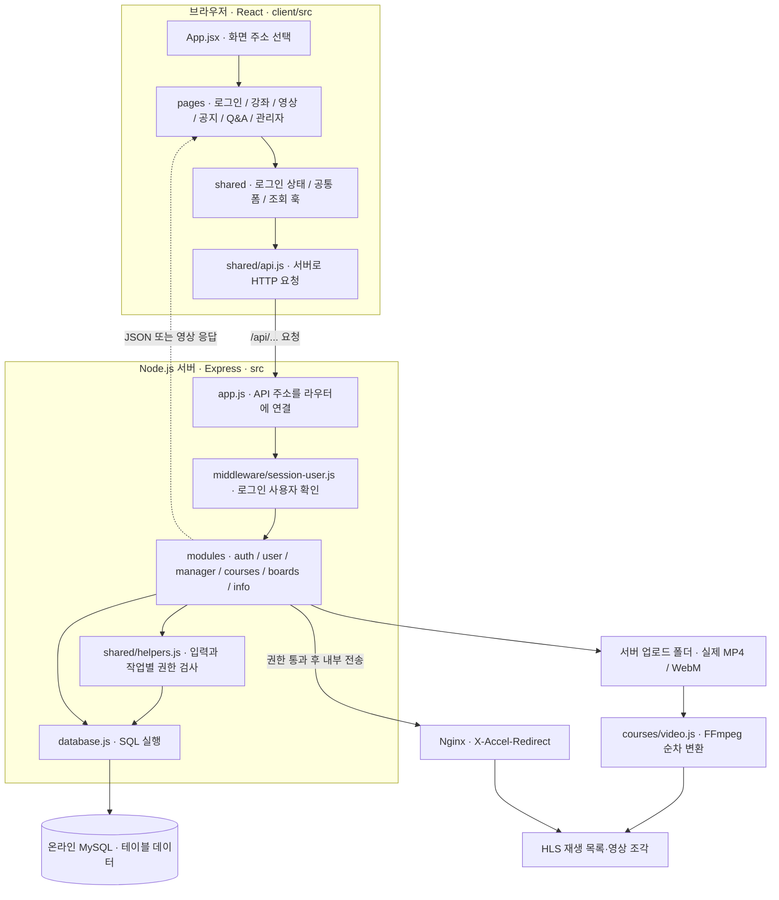
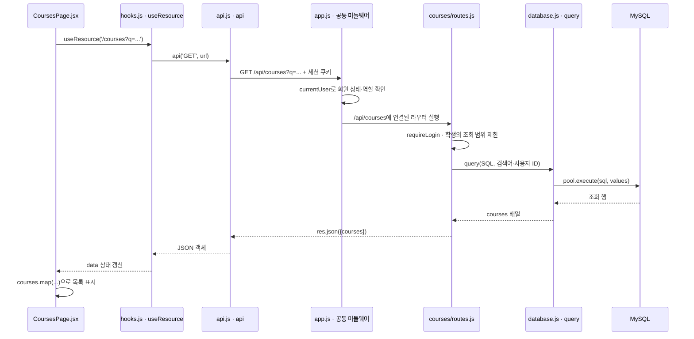
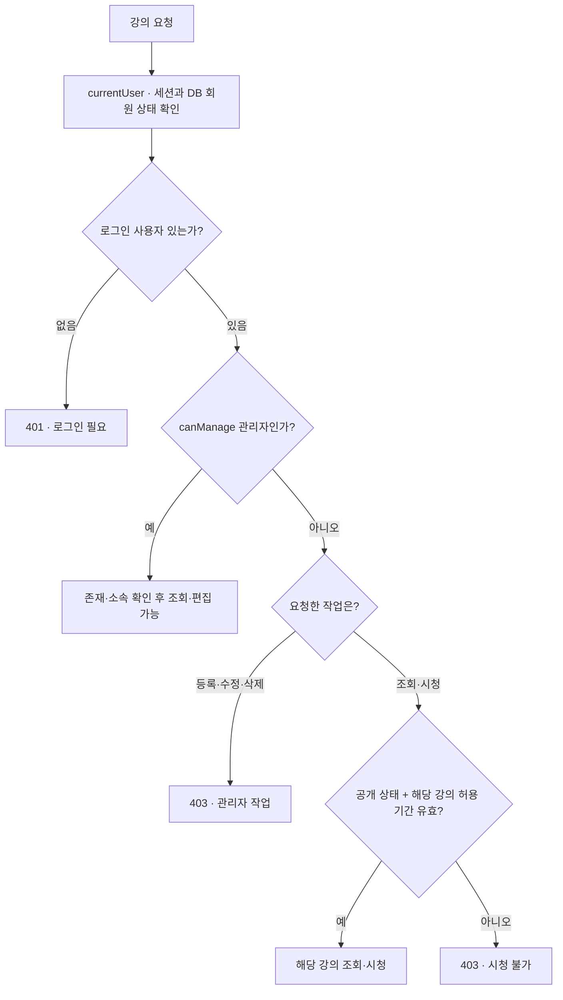
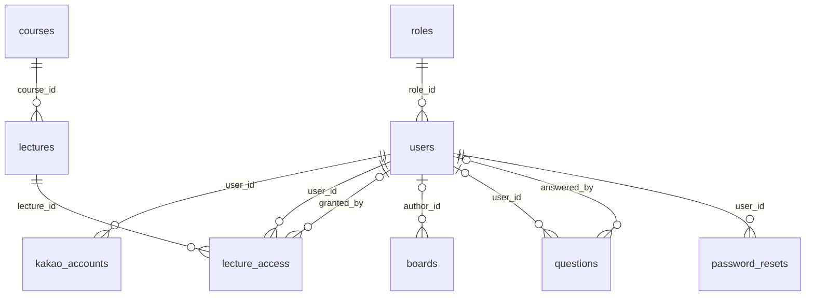

# MathSite 구조 지도

현재 로컬 코드 기준: 2026-11-14. 이 문서는 **화면, 서버 API, 권한, 저장 데이터, 실제 파일의 연결**을 보여 준다. 새로 만들 구조를 제안하는 문서가 아니라 현재 구현된 구조를 읽는 지도다.

읽는 순서는 **전체 구조 → 기능별 연결 → 강좌 조회 흐름 → 데이터 관계 → 폴더 위치**다. 개별 함수는 [함수 안내서](functions.md)에서 찾아본다.

시작 문서는 [인수인계서](HANDOFF.md)다. [기획·구현 비교표](requirements-status.md)에는 이번에 추가한 일반 가입·아이디 로그인·FFmpeg/Nginx·채널 설정·팝업과 외부 계정 연결 상태를 구분했다.

## 1. 전체 구조



`client/src`와 루트 `src`는 실행 위치가 다르다. 화면은 서버에 요청하고, 서버가 권한을 검사해 MySQL과 파일을 다룬다. 브라우저는 MySQL에 직접 연결하지 않는다. 위 서버 상자는 요청이 거치는 주요 책임을 요약한 것으로, 세부 호출은 기능마다 다르다.

React 화면 파일을 전달하는 시작 연결은 다음과 같다.

```text
npm run dev
  → src/server.js가 src/app.js를 불러와 Express 앱 구성
  → MySQL 연결 확인
  → src/frontend.js가 Vite 개발 연결 준비
  → HTTP 서버 실행
  → 브라우저가 / 요청
  → client/index.html → client/src/main.jsx → App.jsx
```

`npm start`는 React를 빌드한 뒤 서버를 실행하고 `src/frontend.js`가 `dist/client` 파일을 제공한다.

## 2. 기능별 연결 지도

화면 파일의 기준 폴더는 `client/src`, 서버 파일의 기준 폴더는 루트 `src`다. 행 하나를 가로로 읽으면 한 기능의 앞뒤를 따라갈 수 있다.

| 기능                             | 화면 파일                                                  | 서버 요청 주소                           | 서버 처리 파일                                                                                     | 주요 테이블·저장소                                        |
| -------------------------------- | ---------------------------------------------------------- | ---------------------------------------- | -------------------------------------------------------------------------------------------------- | --------------------------------------------------------- |
| 아이디·이메일 가입/로그인/재설정 | `pages/LoginPage.jsx`, `RegisterPage.jsx`, `ResetPage.jsx` | `/api/auth/...`                          | `modules/auth/controller.js`, `mail.js`                                                            | `users`, `roles`, `password_resets`, SMTP                 |
| 카카오 로그인·연결               | `pages/LoginPage.jsx`, `pages/ProfilePage.jsx`             | `/auth/kakao/...`, `/api/auth/kakao/...` | `modules/auth/kakao.routes.js` → `kakao.controller.js` → `kakao.client.js` / `kakao.repository.js` | 카카오 외부 API, `kakao_accounts`, `users`, `roles`       |
| 내 정보                          | `pages/ProfilePage.jsx`                                    | `/api/user`                              | `modules/user/routes.js`                                                                           | `users`, `roles`                                          |
| 강좌 목록·상세                   | `pages/CoursesPage.jsx`                                    | `/api/courses`, `/api/courses/:courseId` | `modules/courses/routes.js`                                                                        | `courses`, 조회 권한 확인 시 `lectures`, `lecture_access` |
| 강의 목록·시청                   | `pages/CoursesPage.jsx`, `pages/LecturePage.jsx`           | `/api/courses/:courseId/lectures/...`    | `modules/courses/lectures.routes.js`                                                               | `lectures`, `courses`, `lecture_access`, 영상 파일        |
| 회원 승인·정지·시청 권한         | `pages/manager/MemberManager.jsx`                          | `/api/manager/users/...`                 | `modules/manager/routes.js`                                                                        | `users`, `roles`, `lectures`, `lecture_access`            |
| 관리자 강좌 편집                 | `pages/manager/CourseManager.jsx`                          | `/api/courses/...`                       | `modules/courses/routes.js`                                                                        | `courses` 및 삭제되는 소속 강의·영상                      |
| 관리자 강의·영상 편집            | `pages/manager/LectureManager.jsx`                         | `/api/courses/:courseId/lectures/...`    | `modules/courses/lectures.routes.js`                                                               | `lectures`, 영상 파일                                     |
| 공지                             | `pages/BoardsPage.jsx`                                     | `/api/boards/...`                        | `modules/boards/routes.js`                                                                         | `boards`                                                  |
| 질문·답변                        | `pages/InfoPage.jsx`                                       | `/api/info/qna/...`                      | `modules/info/routes.js`                                                                           | `questions`                                               |

**강좌와 강의의 연결**

```text
/api/courses                               강좌 라우터
└─ /:courseId                              특정 강좌
   └─ /lectures                            그 강좌의 강의 라우터
      └─ /:lectureId                       특정 강의·영상
         └─ /playback                      시청 권한 확인 후 재생 주소 응답
```

`courses/routes.js`와 `courses/lectures.routes.js`는 별도 파일이다. `router.use('/:courseId/lectures', ...)`가 두 파일을 연결한다. 현재 `/lectures`를 최상위 별도 주소로 사용하는 구조는 아니다.

**관리자 화면의 연결**

```text
/manager 화면 → ManagerPage.jsx
├─ MemberManager.jsx   → /api/manager/...       회원·시청 권한
├─ CourseManager.jsx   → /api/courses/...       강좌 편집
└─ LectureManager.jsx  → /api/courses/.../lectures/...  영상 편집
```

화면 주소가 `/manager`라고 해서 모든 요청을 `/api/manager`에서 처리하지는 않는다. 강좌 편집은 강좌 API에, 영상 편집은 강의 API에 요청하고 해당 API가 관리자인지 확인한다.

## 3. 강좌 조회 한 건을 따라가는 지도



학생에게 보여 줄 강좌 범위는 서버 SQL에서 결정한다. 시청 가능한 공개 강의가 없는 학생은 빈 강좌 목록을 받는다. 권한 없는 강좌 ID를 직접 요청하면 403을 받는다.

### 실제 파일을 여는 순서

1. [CoursesPage.jsx](../client/src/pages/CoursesPage.jsx) — `useResource(...)`를 찾는다.
2. [hooks.js](../client/src/shared/hooks.js) — `api('GET', url)`을 찾는다.
3. [api.js](../client/src/shared/api.js) — `fetch('/api' + path)`를 찾는다.
4. [app.js](../src/app.js) — `/api/courses`에 연결한 파일을 찾는다.
5. [courses/routes.js](../src/modules/courses/routes.js) — `router.get('/')`의 SQL과 `res.json`을 본다.
6. [database.js](../src/database.js) — `pool.execute`와 반환 값을 본다.

## 4. 로그인과 시청 권한 지도



이 그림은 강의 요청을 요약한다. 다른 기능은 그 기능의 규칙을 적용한다. 예를 들어 질문 수정은 작성자만 가능하다.

| 계정 상태                       | 관리자 화면 | 강좌·영상 조회                              | 강좌·영상 편집 |
| ------------------------------- | ----------- | ------------------------------------------- | -------------- |
| 활성 관리자                     | 접근 가능   | 비공개 포함 조회 가능                       | 가능           |
| 활성 학생 + 특정 강의 시청 허용 | 접근 불가   | 허용된 공개 강의만 시청                     | 불가           |
| 활성 학생 + 시청 허용 없음      | 접근 불가   | 강좌 목록이 비어 있고 직접 강의 접근은 거절 | 불가           |
| 승인 대기·정지                  | 로그인 불가 | 불가                                        | 불가           |

**관리자 권한**은 `roles.can_manage`, **개별 영상 시청 권한**은 `lecture_access`로 구분한다. 학생 역할이 같아도 시청 가능한 강의가 다를 수 있다. 화면의 메뉴 숨김은 `shared/auth.jsx`·`shared/components.jsx`, 실제 요청 차단은 서버 `requireAdmin`·`getCourse`·`getLecture`가 맡는다.

## 5. 데이터 관계 지도



하나의 강좌는 여러 강의를 가진다. 한 학생은 여러 강의의 시청 권한을 받을 수 있고, 한 강의도 여러 학생에게 허용될 수 있으므로 중간 테이블 `lecture_access`를 사용한다. 여기에는 시작·만료 시각도 들어간다.

강의의 `video_file`에는 서버에 저장한 파일명만 있다. **영상 바이트는 MySQL에 넣지 않는다.** 원본과 FFmpeg 변환 결과를 서버에 저장하고 `hls_key`로 현재 HLS 폴더를 찾는다. Nginx는 Express가 권한을 승인한 파일을 내부 전송한다. Moodle 연동은 사용하지 않았다.

## 6. 코드 폴더 지도

```text
MathSite/
├─ client/                                화면 코드
│  ├─ index.html                          React가 들어갈 HTML 틀
│  └─ src/                                브라우저에서 실행
│     ├─ main.jsx                         React 실행 시작
│     ├─ App.jsx                          화면 주소표
│     ├─ style.css                        기본 서식
│     ├─ shared/                          화면 공통 코드
│     │  ├─ api.js                        HTTP 요청
│     │  ├─ hooks.js                      조회·저장 상태
│     │  ├─ auth.jsx                      로그인 상태·화면 접근
│     │  ├─ components.jsx                메뉴·제목·입력 폼
│     │  ├─ PopupNotice.jsx               공지 팝업
│     │  └─ VideoPlayer.jsx               원본·HLS 플레이어
│     └─ pages/                           화면별 코드
│        ├─ LoginPage.jsx                 로그인·카카오 추가 가입
│        ├─ RegisterPage.jsx              일반 회원가입
│        ├─ ResetPage.jsx                 비밀번호 재설정
│        ├─ ProfilePage.jsx               내 정보
│        ├─ CoursesPage.jsx               강좌 목록·상세·강의 목록
│        ├─ LecturePage.jsx               영상 시청
│        ├─ BoardsPage.jsx                공지
│        ├─ InfoPage.jsx                  소개·질문·답변
│        └─ manager/                      관리자 화면
│           ├─ ManagerPage.jsx            관리 화면 조립
│           ├─ MemberManager.jsx          회원 상태·시청 권한
│           ├─ CourseManager.jsx          강좌 편집
│           ├─ LectureManager.jsx         강의·영상 편집
│           ├─ RoleManager.jsx            역할 CRUD
│           └─ SiteSettings.jsx           채널·메일 설정 상태
├─ src/                                   Node.js에서 실행
│  ├─ server.js                           서버 실행 시작
│  ├─ app.js                              공통 처리·API 주소표
│  ├─ frontend.js                         React 개발·빌드 파일 제공
│  ├─ database.js                         MySQL 연결·query
│  ├─ middleware/
│  │  └─ session-user.js                  현재 사용자·출처 확인
│  ├─ shared/
│  │  └─ helpers.js                       검증·비밀번호·권한·파일 공통 처리
│  └─ modules/                            기능별 서버 코드
│     ├─ auth/
│     │  ├─ routes.js                     이메일 인증 주소표
│     │  ├─ controller.js                 이메일 인증 처리
│     │  ├─ mail.js                       SMTP·로컬 시험 메일 전달
│     │  ├─ session.js                    로그인 세션 공통 처리
│     │  ├─ kakao.routes.js               카카오 주소표
│     │  ├─ kakao.controller.js           카카오 인증 흐름
│     │  ├─ kakao.client.js               카카오 외부 API 통신
│     │  ├─ kakao.repository.js           우리 DB의 카카오 연결 정보
│     │  └─ kakao.config.js               카카오 설정 검사
│     ├─ user/routes.js                   본인 회원 정보
│     ├─ manager/routes.js                회원·역할·시청 권한 관리
│     ├─ courses/
│     │  ├─ routes.js                     강좌 API
│     │  ├─ lectures.routes.js            강좌 하위 강의·영상 API
│     │  └─ video.js                      FFmpeg 순차 변환·취소·복구
│     ├─ boards/routes.js                 공지 API
│     └─ info/
│        ├─ routes.js                     질문·답변 API
│        └─ settings.routes.js            채널 설정 API
├─ database/
│  ├─ schema.sql                          테이블 구조
│  ├─ migrate.js                          기존 DB를 유지하는 열 추가
│  └─ certs/filess-ca.pem                  온라인 DB 검증용 공개 인증서
├─ tests/                                 Mocha 검사
│  ├─ api.test.js                         기능·권한·영상 API 검사
│  ├─ features.test.js                    추가 기능·실제 FFmpeg·Nginx 검사
│  ├─ kakao.test.js                       카카오 인증 흐름 검사
│  ├─ database-env.js                     로컬 테스트 DB 강제
│  ├─ http-client.js                      사용자별 쿠키·요청 도구
│  ├─ seed.js                             합성 시험 자료
│  └─ fixtures/sample.mp4                 시험용 영상
├─ scripts/
│  ├─ init-db.js                          스키마·최초 계정 준비
│  ├─ local-db.js                         전용 로컬 MySQL 시작·중지
│  └─ nginx.js                            전용 Nginx 설정·시작·중지
├─ server/nginx.conf.template              권한 통과 후 내부 영상 전송
├─ docs/
│  ├─ architecture.md                     지금 보는 구조 지도
│  ├─ HANDOFF.md                          인수인계·실행·수정·운영
│  ├─ API.md                              전체 API·권한·입력 형식
│  ├─ code-map.md                         코드 읽는 순서
│  ├─ functions.md                        각 파일·함수 설명
│  └─ kakao-setup.md                      카카오 설정 방법
├─ README.md                              실행·설정 기본 안내
├─ package.json / package-lock.json       명령·패키지 / 설치 버전 고정
├─ vite.config.mjs                        React 개발·빌드 연결
└─ .env.example                          비공개 설정의 양식
```

추가 개발 설정은 `.gitignore`, `.gitattributes`, `.editorconfig`, `.prettierrc.json`, `.prettierignore`, `.vscode/settings.json`이다. 실제 비밀번호가 들어 있는 `.env`, 설치된 패키지 `node_modules`, 생성물 `dist`, 비공개 실행 자료 `.local`은 기능 코드와 구분한다.

## 7. 우리가 설계하고 구현할 때의 순서

1. **작업과 사용자를 정한다.** 예: 학생은 허용된 영상을 본다. 관리자는 강의·영상을 등록하고 시청 권한을 준다.
2. **데이터 관계를 정한다.** 회원 → 시청 권한 → 강의 → 강좌. 각 ID가 무엇을 가리키는지 정한다.
3. **API 약속을 적는다.** 메서드·주소·입력·성공 응답·거절 조건을 정한다.
4. **한 기능의 서버 흐름을 구현한다.** 라우터 → 검증·권한 → SQL → 응답 순서로 만든다.
5. **Mocha로 허용·거절을 확인한다.** 관리자, 허용 학생, 미허용 학생이 같은 API를 요청하는 경우를 검사한다.
6. **그 API에 화면을 연결한다.** React 화면에서 입력을 받고 결과를 표시한다.

지금 공부할 첫 범위는 **강좌 목록 GET 하나**다. 위 3번 지도의 여섯 파일을 따라가며 입력·권한·SQL·응답을 자기 말로 설명한 뒤, 강의 시청과 권한 부여로 범위를 넓힌다.
